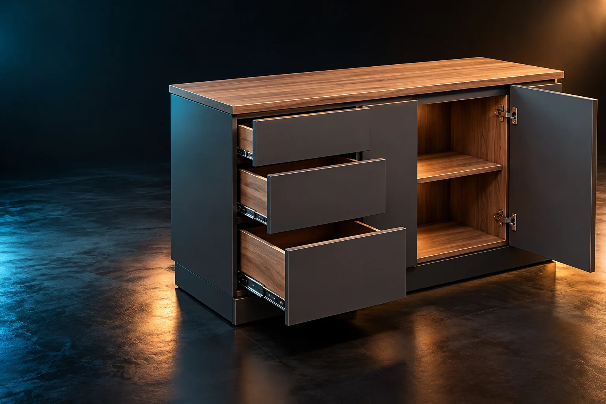

# JOQBAY / 3D — Parametric Studio

**Um laboratório público de modelagem paramétrica 3D para a web.**

[](https://vuejs.org/)
[](https://www.typescriptlang.org/)
[](https://threejs.org/)
[](https://vitest.dev/)

> **Estado:** demonstração interativa de portfólio, em evolução. **Não é software de produção industrial** nem contém regras validadas para fabricação.

O projeto permite configurar um módulo conceitual de marcenaria por **largura, altura, profundidade, espessura, estrutura, frente e acabamento**. O visitante pode orbitar a câmera, selecionar painéis individuais, alternar tema escuro/claro, escolher três modelos iniciais, explorar uma composição linear de cozinha e exportar uma imagem PNG ou um JSON de demonstração.



## Funcionalidades disponíveis

- Interface responsiva e _mobile-first_, com navegação lateral e navegação adaptada para celular.
- Páginas de visão geral, configurador 3D, biblioteca de modelos e arquitetura.
- Temas **dark/light**, com preferência salva no navegador.
- Prévia 3D real com **Three.js**, seleção de painéis, zoom e órbita.
- Campos dimensionais em milímetros, validação de entrada e feedback.
- Prévia geométrica isolada em um **adaptador local substituível**, sem exigir servidor ou contas.
- Modelos **balcão, aéreo e torre**; persistência do rascunho no `localStorage`.
- Alternância entre **laterais passantes** e **topo/base passantes** com geometria recalculada.
- **Tampo e base com profundidade total**, fundo demonstrativo de **6 mm** separado da espessura estrutural.
- Frentes opcionais (sem portas, duas portas, três frentes de gaveta ilustrativas).
- Quatro acabamentos: grafite, carvalho, linho e branco TX.
- **Ambiente cozinha**: balcão, gaveteiro conceitual, torre fria conceitual e aéreo, com seleção e ajuste de medidas/acabamentos por módulo.
- Recursos Three.js de **vista explodida animada** e **giro automático**, além de órbita, seleção e exportação.
- Exportação de PNG da cena e JSON conceitual.
- Testes do adaptador de prévia e da integração básica da interface.

## Limites explícitos da geometria

Esta versão **não** é um configurador de fabricação: os painéis são formas básicas ilustrativas. O fundo tem espessura visual de 6 mm, mas **não há rasgo, rebater ou instalação**; as portas não possuem dobradiças e seus puxadores são puramente visuais; as frentes de gaveta não representam caixas, fundos, corrediças ou ferragens; a torre fria **não inclui geladeira**. A cozinha é uma **composição linear pré-definida**, sem paredes, bancadas de pedra, eletrodomésticos ou ergonomia de ambiente. Dimensões e área são apenas referências para estudo visual.

## Executar localmente

Requisitos: **Node.js 24 LTS** (ou versão compatível com `package.json`), npm e navegador com WebGL.

```powershell
# PowerShell — na pasta do projeto
npm install
npm run dev
```

Abra o endereço exibido pelo Vite, normalmente `http://localhost:5173`.

> Importante para quem aplicar o patch ao scaffold anterior: `npm install` instalará `three` e `@types/three` e atualizará `package-lock.json`. **Versione o lock atualizado** no mesmo PR. Após isso, instalações limpas em CI podem usar `npm ci`.

## Qualidade e testes

```powershell
npm run test:ci
npm run type-check
npm run lint:check
npm run build
```

O `npm run lint` do scaffold corrige arquivos automaticamente; para uma checagem sem modificar arquivos, use `npm run lint:check`.

Testes cobrem a estrutura passante, o fundo de 6 mm, as frentes de portas/gaveta ilustrativas, a composição de cozinha e a edição isolada de módulos, além de validação, interação Vue e navegação. O ambiente de teste da aplicação simula o viewport WebGL; não substitui validação manual 3D nem um teste E2E no navegador real.

## Visão arquitetural

```text
Browser / Vue 3 + TypeScript
│
├── Views + Components ───────── UI, formulários, navegação e temas
├── Contracts ───────────────── formatos de configuração e painéis
├── Local Preview Adapter ───── MOCK GEOMÉTRICO TEMPORÁRIO
│                                 (não autoritativo, não fabricável)
├── Kitchen Composition ──────── combinação e posicionamento dos módulos
└── Three Renderer Adapter ──── WebGL, câmera, meshes e interação

Futuro:
       Vue  ── HTTP/JSON ──► NestJS / Application / Domain
                                  │
                                  └─► Python (otimização especializada)
```

**Separação fundamental:** Vue e Three.js **não determinam regras industriais autoritativas**. Atualmente o cálculo local existe **somente para demonstração visual**. Numa evolução com servidor, o adapter será substituído por um cliente HTTP; validações e regras de fabricação pertencerão ao domínio do backend em NestJS, independentemente do renderer.

| Área               | Responsabilidade                                            |
| ------------------ | ----------------------------------------------------------- |
| `src/contracts/`   | Tipos independentes de framework; formato de entrada/saída. |
| `src/application/` | Presets e adaptador local provisório de prévia geométrica.  |
| `src/composables/` | Estado/persistência do tema e do rascunho.                  |
| `src/components/`  | Controles, navegação e viewport Vue.                        |
| `src/views/`       | Páginas e composição da experiência.                        |
| `src/three/`       | Tradução para Three.js; GPU, câmera, raycasting e cleanup.  |
| `src/styles/`      | Tokens globais de tema e estilos compartilhados.            |

Leia [docs/ARCHITECTURE.md](docs/ARCHITECTURE.md) para decisões e limites, e [docs/ROADMAP.md](docs/ROADMAP.md) para o planejamento.

## Publicar na Vercel

1. Faça push do repositório para o GitHub.
2. Importe o repositório na Vercel como projeto **Vite**.
3. Instale as dependências e use `npm run build` para produzir `dist/`.
4. Configure o diretório de saída como `dist`.

É um projeto estático e pode ser hospedado sem servidor. Não há rotas HTML adicionais: a navegação usa fragmentos (`#studio`, `#templates`), compatíveis com hosting estático simples.

O botão **Exportar JSON** gera dados locais e **não** salva registros no servidor. A composição de ambiente não é persistida nesta edição: use **Restaurar composição** para recuperar o cenário inicial. Não há autenticação, contas, preços, ordens de produção ou plano de corte operacional na versão atual.

## Relação com o ecossistema SketchUp

Existe um **projeto privado e independente** em desenvolvimento voltado a uma extensão paramétrica para SketchUp, cuja integração com a API do SketchUp utiliza **Ruby**. Este repositório público é **um estudo paralelo de tecnologias web**, sem publicar código, ativos proprietários, fórmulas internas ou outras informações do plugin comercial.

A evolução de backend web considerada para o ecossistema mais amplo — incluindo possíveis aplicações de ERP, PCP e serviços relacionados — é **NestJS + TypeScript**, com **Python** como possível serviço especializado para otimização. Esses sistemas **não estão implementados aqui**.

## Colaboração e contexto

A implementação explora práticas de desenvolvimento assistido por IA, sempre com revisão humana de arquitetura, requisitos, testes e mudanças. Nomes de símbolos estão em inglês; a documentação e explicações de domínio estão em português.

**Licenciamento:** o repositório pode ser público para consulta e avaliação; não há licença de reutilização definida neste momento. Uma licença explícita deverá ser escolhida antes de disponibilizá-lo como open source.
